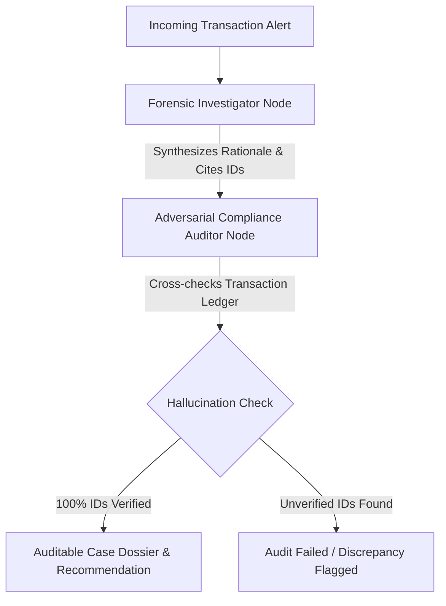

# FinSentry 🛡️
### Auditable Multi-Agent Financial Crime Investigation & Evaluation Harness

[](https://www.python.org/)
[](https://github.com/langchain-ai/langgraph)
[](https://fastapi.tiangolo.com/)
[](LICENSE)

**FinSentry** is an autonomous Anti-Money Laundering (AML) investigation and compliance governance pipeline built with **LangGraph** and **FastAPI**. 

Banks and financial institutions spend over 90% of compliance hours manually reviewing alerts that turn out to be false alarms. FinSentry bridges this operational bottleneck by deploying specialized agents that autonomously investigate transactions, detect criminal typologies (Structuring, Smurfing, Rapid Movement), enforce deterministic evidence citations against the ledger, and generate fully auditable Case Dossiers for human analysts.

---

## 🏗️ Architecture Overview

FinSentry decouples the investigation process into a multi-agent state graph with strict adversarial compliance governance:



### Key Workflow Components
1. **Forensic Investigator Node**:
   - Performs heuristic checks comparing declared monthly income to transaction velocity.
   - Detects thresholds evasion (e.g., repeated cash deposits just below regulatory limits).
   - Discerns genuine economic activity (e.g., verified escrow, payroll, business invoicing).
2. **Compliance Auditor Node (Deterministic Guardrail)**:
   - Evaluates the investigator's output against the raw transaction database.
   - Strictly enforces that **100% of cited evidence transaction IDs exist** in the ledger, preventing hallucinations before case generation.
3. **Structured Dossier Output**:
   - Compiles findings into a standardized audit-ready schema containing typologies, risk scores, rationale, and proof references.

---

## 📊 Benchmark Evaluation Results

FinSentry features an integrated **Evaluation Harness** that benchmarks agent classification accuracy and citation grounding against synthetic transactional scenarios:

| Alert ID | Subject | Ground Truth | Agent Verdict | Correct? | Audit Status | Risk Level |
|---|---|---|---|:---:|:---:|:---:|
| **ALT-101** | Arun Kumar | `ESCALATE_SUSPICIOUS` | `ESCALATE_SUSPICIOUS` | ✅ Yes | ✅ Audit Passed | **HIGH** |
| **ALT-102** | Sarah Jenkins | `FALSE_POSITIVE` | `FALSE_POSITIVE` | ✅ Yes | ✅ Audit Passed | **LOW** |
| **ALT-103** | Vikram Patel | `ESCALATE_SUSPICIOUS` | `ESCALATE_SUSPICIOUS` | ✅ Yes | ✅ Audit Passed | **HIGH** |

### Benchmark Metrics
- **Typology Classification Accuracy:** `100.0%`
- **Evidence Grounding Score:** `100.0%` (Zero hallucinated transaction citations)

---

## 💡 Live Output Example

Here is an actual investigation response generated by FinSentry via the REST API for a smurfing alert:

```json
{
  "alert_id": "ALT-101",
  "account_holder": "Arun Kumar",
  "dossier": {
    "verdict": "ESCALATE_SUSPICIOUS",
    "risk_level": "HIGH",
    "primary_typology": "Structuring / Smurfing",
    "cited_transaction_ids": [
      "TXN-01",
      "TXN-02"
    ],
    "investigator_rationale": "The account holder declares a monthly income of $2,500, yet received two cash deposits of $9,850 and $9,600 within a 48‑hour window—totaling $19,450, which is over 7.8 times the declared income. Both deposits are just below the $10,000 reporting threshold, a classic indicator of structuring to avoid detection. No legitimate economic purpose is evident from transaction descriptions. Therefore, the alert warrants escalation for further investigation.",
    "audit_notes": "AUDIT PASSED: All 2 cited evidence IDs exist in transactional ledger."
  },
  "audit_trail": "AUDIT PASSED: All 2 cited evidence IDs exist in transactional ledger."
}
```

---

## 🛠️ Tech Stack

- **Agent Orchestration:** [LangGraph](https://github.com/langchain-ai/langgraph) (`StateGraph` state machines)
- **Model Layer:** Open-weight reasoning models via Groq API (`openai/gpt-oss-20b`, `llama-3.1`)
- **API Framework:** [FastAPI](https://fastapi.tiangolo.com/), [Uvicorn](https://www.uvicorn.org/)
- **Data Validation & Schemas:** Pydantic v2
- **Evaluation & Benchmarking:** Custom LLM-as-a-judge evaluation harness with tabular metrics reporting

---

## 🚀 Getting Started

### 1. Clone & Set Up Virtual Environment
```bash
git clone https://github.com/<YOUR_GITHUB_USERNAME>/FinSentry.git
cd FinSentry

python -m venv venv
# On Windows (PowerShell):
venv\Scripts\activate
# On Linux/macOS:
source venv/bin/activate
```

### 2. Install Dependencies
```bash
pip install -r requirements.txt
```

### 3. Set API Credentials
```bash
# On Windows (PowerShell):
$env:GROQ_API_KEY="your-groq-api-key"

# On Linux/macOS:
export GROQ_API_KEY="your-groq-api-key"
```

### 4. Run the Evaluation Suite
```bash
python evals.py
```

### 5. Start the REST API Service
```bash
uvicorn main:app --reload
```
Navigate to `http://127.0.0.1:8000/docs` to interact with the Swagger documentation and trigger alerts.

---

## 📁 Repository Structure

```text
finsentry/
├── agent.py               # LangGraph state machine, investigator & auditor nodes
├── scenarios.py           # Synthetic transaction data generator & alert benchmark models
├── evals.py               # Automated evaluation harness & grounding verification
├── main.py                # FastAPI REST server endpoints
├── requirements.txt       # Project dependencies
└── README.md              # Project documentation and benchmarks
```

---

## ⚖️ License
This project is licensed under the Apache 2.0 License.
